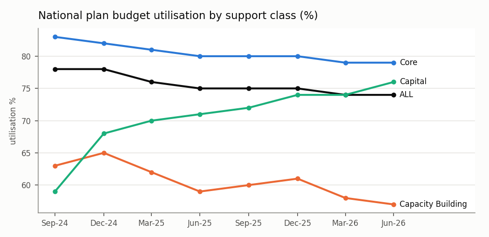
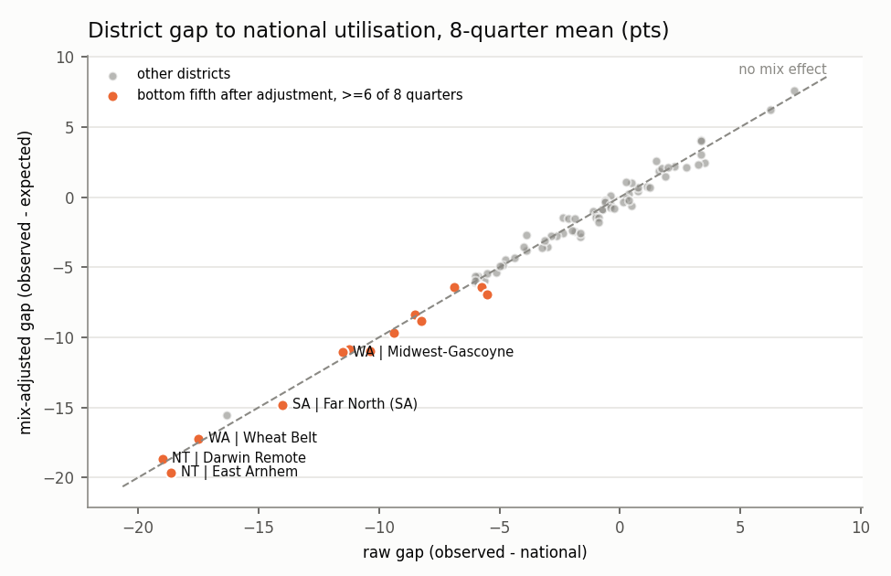
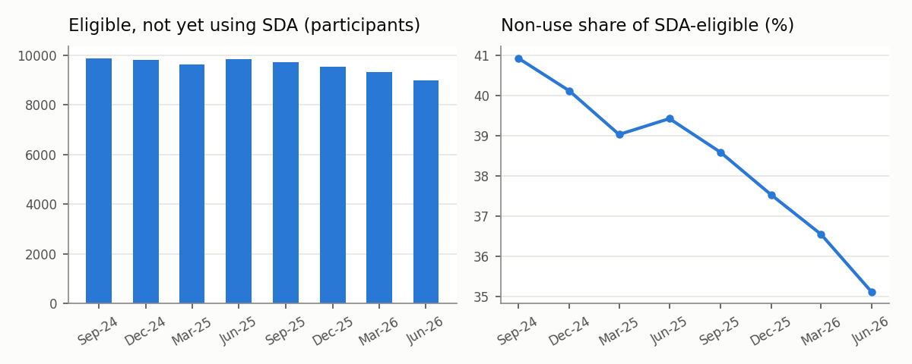
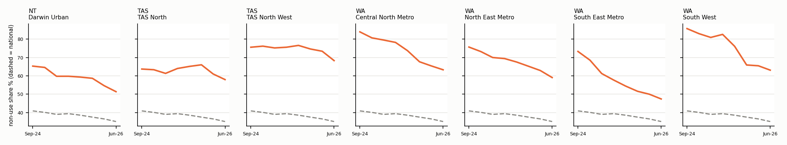
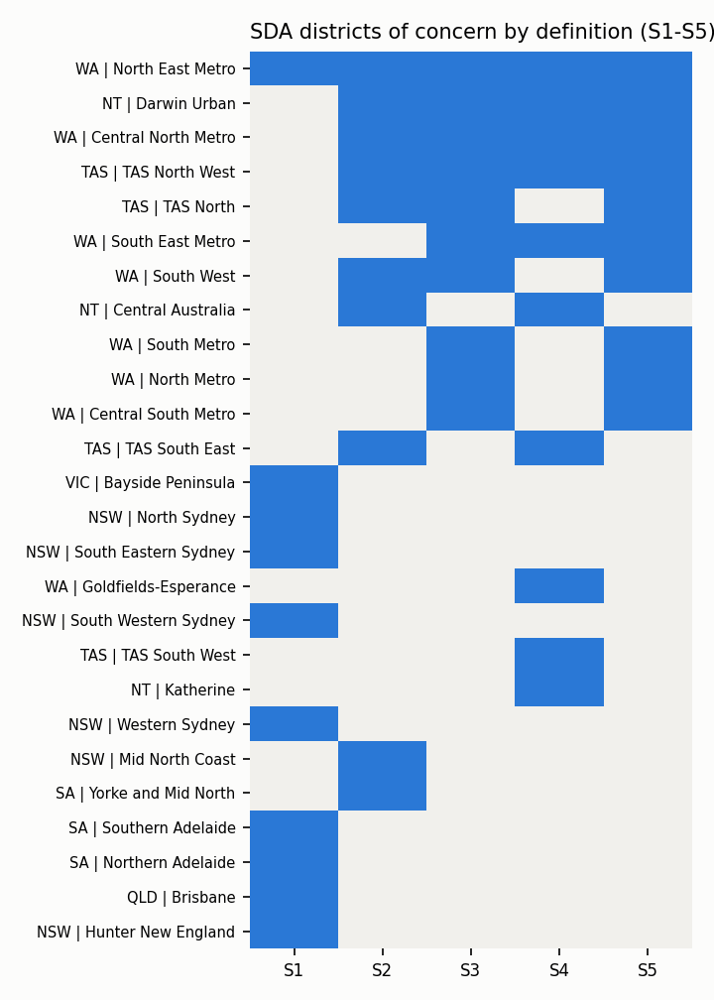

# Funding Is Not Access: NDIS Support Access & Service Gap Intelligence

*Generated by `src/run_pipeline.py` from NDIA public datasets (reporting dates 30-Sep-2024 to 30-Jun-2026).
Every figure below is read from the pipeline tables; rerunning on a new NDIA release regenerates this report.*

**Central question:** when funding is available, does it translate into support being used?

## 1. Data and validation

| Source (NDIA) | Grain | Periods |
|---|---|---|
| Participant numbers and plan budgets | state x service district x disability x age band x support class | 8 quarters |
| Utilisation of plan budgets | the same + SIL/SDA flag | 8 quarters (lagged 6-month window) |
| SDA participants | state x service district x SDA status | 8 quarters |
| SDA enrolled dwellings and NDIS demand (Supplement P) | SA4 / SA3 region | 30-Jun-2026 only |

Reconciliation results (122 checks): PASS 120, WARN 2.
Load counts match every source file; states add to the national total every quarter; SDA district counts agree
with the NDIA SDA supplement where both publish a number. Explained variances:

| check_id | description | expected | actual | note |
|---|---|---|---|---|
| X-SDA-district-values | 30-Jun-2026 district SDA counts: CSV vs supplement Table P.1 (140 cells both unmasked) | 0 | 1 | max absolute difference 1; separate extracts |
| X-active-ACT | 30-Jun-2026 ACT active participants: budgets CSV vs SDA supplement P.1 | 12694 | 12695 | supplement and CSV are separate NDIA extracts; differences of a few participants are WARN |

**Grain rules applied** (from the NDIA data rules):
- Utilisation covers supports delivered in a 6-month window ending 3 months before the reporting date; budgets are point-in-time. They are shown together only with that window labelled (`dim_period`).
- Age bands changed in Dec-2024 (0-6 / 7-14 -> 0-8 / 9-14). Trend analysis by age uses the harmonised band `0 to 14`.
- Masked cells (`<11`, and complementary masks such as `<12699`) are never imputed in published-value columns. Where a named district's state-level row is complementary-masked, the district total (state = ALL) is used only if it is within the mask bound, and flagged (`participants_source`).
- SDA dwellings are published by SA4, participants by service district. The two are **never joined**; dwellings appear only as regional context.
- The SDA file labels residual districts `<STATE> - Other` and Tasmanian districts differently from the SDA supplement; labels are normalised before comparison.

## 2. Module A: Funding-Utilisation

National utilisation fell from 78% to 74% between 30-Sep-2024 and 30-Jun-2026.
A budget-weighted shift-share decomposition asks whether this came from **changing composition**:

| Decomposition | Mix effect (pts) | Within-group rate effect (pts) |
|---|---|---|
| Support class (Core / Capacity Building / Capital) | -0.07 | -3.63 |
| Participant mix (disability x age, harmonised) | -0.02 | -3.82 |

**Reading:** almost none of the fall is explained by mix; utilisation fell *within* groups. (NDIA publishes whole percentages, so effects under ~0.5 pt are within rounding.)

### Is low utilisation persistent, and does it survive a like-for-like comparison?

Each district's expected rate is what it would show at national rates for its own disability x age mix
(budget-weighted, indirect standardisation). The adjusted gap is observed - expected.

| District | Q bottom (raw) | Q bottom (adj) | Mean util % | Mix effect pts | Adj gap pts | Cell coverage % |
|---|---|---|---|---|---|---|
| NT \| East Arnhem | 8 | 8 | 57.0 | 1.0 | -19.6 | 21.0 |
| NT \| Darwin Remote | 8 | 8 | 56.6 | -0.3 | -18.7 | 38.0 |
| WA \| Wheat Belt | 8 | 8 | 58.1 | -0.2 | -17.3 | 61.0 |
| SA \| Far North (SA) | 8 | 8 | 61.6 | 0.8 | -14.8 | 37.0 |
| WA \| Midwest-Gascoyne | 8 | 8 | 64.1 | -0.4 | -11.1 | 63.0 |
| NSW \| Far West | 8 | 8 | 65.3 | 0.6 | -11.0 | 51.0 |
| SA \| Eyre and Western | 8 | 8 | 64.4 | -0.4 | -10.9 | 72.0 |
| WA \| Goldfields-Esperance | 8 | 7 | 66.3 | 0.3 | -9.7 | 52.0 |
| WA \| Great Southern | 8 | 8 | 67.4 | 0.6 | -8.9 | 63.0 |
| SA \| Yorke and Mid North | 8 | 8 | 67.1 | -0.1 | -8.4 | 72.0 |
| VIC \| Western District | 6 | 8 | 70.1 | 1.4 | -6.9 | 92.0 |
| NSW \| Western NSW | 8 | 8 | 69.9 | 0.6 | -6.4 | 97.0 |
| QLD \| Rockhampton | 8 | 6 | 68.8 | -0.5 | -6.4 | 96.0 |
| NSW \| Southern NSW | 7 | 5 | 69.6 | 0.1 | -6.1 | 93.0 |
| SA \| Limestone Coast | 6 | 3 | 70.0 | 0.3 | -5.9 | 70.0 |
| WA \| South West | 6 | 4 | 69.6 | -0.1 | -5.9 | 93.0 |
| VIC \| Loddon | 7 | 2 | 69.8 | -0.2 | -5.6 | 97.0 |
| WA \| Kimberley-Pilbara | 8 | 2 | 69.6 | -0.4 | -5.6 | 75.0 |

Points sit almost on the diagonal: in these districts the gap is **not** a mix artefact. The persistently low
districts are overwhelmingly remote and regional (NT, WA, SA, far-west NSW).

## 3. Module B: SDA Access Gap Monitor

**Districts flagged by at least 2 of 5 definitions** (S1 latest count, S2 latest share with eligible >= 30,
S3 8-quarter mean share, S4 per 1,000 active participants, S5 persistently above national):

| District | Not using | Eligible | Share % | Q above natl | Change since Sep-24 | Defs (of 5) |
|---|---|---|---|---|---|---|
| WA \| North East Metro | 202 | 342 | 59.1 | 8 | -53 | 5 |
| WA \| Central North Metro | 169 | 267 | 63.3 | 8 | -66 | 4 |
| NT \| Darwin Urban | 93 | 181 | 51.4 | 8 | -18 | 4 |
| TAS \| TAS North West | 84 | 123 | 68.3 | 8 | -15 | 4 |
| WA \| South East Metro | 165 | 348 | 47.4 | 8 | -79 | 3 |
| TAS \| TAS North | 91 | 157 | 58.0 | 8 | -2 | 3 |
| WA \| South West | 53 | 84 | 63.1 | 8 | -19 | 3 |
| WA \| North Metro | 114 | 244 | 46.7 | 8 | -33 | 2 |
| WA \| South Metro | 105 | 244 | 43.0 | 8 | -58 | 2 |
| WA \| Central South Metro | 98 | 207 | 47.3 | 8 | -50 | 2 |
| TAS \| TAS South East | 78 | 110 | 70.9 | 5 | -10 | 2 |
| NT \| Central Australia | 65 | 78 | 83.3 | 4 | -4 | 2 |

The robust districts are persistently above the national share, but most are falling, so the gap is narrowing,
not widening. The largest absolute numbers are elsewhere: a count-based ranking points to large metropolitan districts:

| District | Not using | Share % |
|---|---|---|
| NSW \| South Western Sydney | 484 | 47.6 |
| NSW \| Hunter New England | 371 | 33.5 |
| QLD \| Brisbane | 367 | 40.9 |
| NSW \| Western Sydney | 365 | 31.6 |
| SA \| Northern Adelaide | 297 | 31.7 |

### Context only: SDA dwellings at SA4 grain (30-Jun-2026)

Enrolled dwellings and resident capacity are **not vacancies** and SA4 regions do not align with service
districts. Shown for WA, TAS and NT, the states of the robust districts:

| SA4 region | Participants with SDA need | Enrolled dwellings | Resident capacity (min) | Unfinished new builds |
|---|---|---|---|---|
| NT - Darwin | 187 | 121 | 255 | 100 |
| NT - Northern Territory - Outback | 128 | 28 | 63 | 19 |
| TAS - Hobart | 231 | 83 | 162 | 99 |
| TAS - Launceston and North East | 157 | 61 | 127 | 34 |
| TAS - West and North West | 123 | 39 | 64 | 7 |
| TAS - South East | 5 | 0 | 0 | 9 |
| WA - Perth - South East | 482 | 375 | 701 | 179 |
| WA - Perth - North West | 432 | 202 | 392 | 107 |
| WA - Perth - North East | 291 | 168 | 319 | 87 |
| WA - Perth - South West | 278 | 279 | 478 | 139 |
| WA - Mandurah | 86 | 113 | 208 | 58 |
| WA - Bunbury | 84 | 43 | 87 | 26 |
| WA - Perth - Inner | 83 | 52 | 63 | 52 |
| WA - Western Australia - Outback (South) | 66 | 15 | 32 | 2 |
| WA - Western Australia - Wheat Belt | 41 | 6 | 9 | 4 |
| WA - Western Australia - Outback (North) | 38 | 1 | 3 | 3 |

## 4. Sensitivity: does the list change with the measure?

- Absolute counts and shares identify **different** districts: the S1 (count) list and the share-based lists overlap little, because large metropolitan districts have many non-users at average shares.
- Districts flagged under >= 3 definitions are treated as robust; others are labelled definition-dependent in the evidence register.
- Minimum-eligible threshold for share ranking:

| min_eligible | districts_ranked | overlap_with_base |
|---|---|---|
| 0 | 69 | 9 |
| 10 | 69 | 9 |
| 20 | 69 | 9 |
| 30 | 68 | 10 |
| 50 | 66 | 9 |
| 100 | 58 | 7 |

## 5. Module C: Evidence register

The register (`outputs/powerbi/an_evidence_register.csv`) holds 91 statements:
20 observed patterns, 51 requiring investigation and
20 unsupported conclusions. Each row records the rule that assigned its status.

### Observed patterns
- **C001** National utilisation moved from 78.0% to 74.0% (30-Sep-2024 to 30-Jun-2026). Changes in support class mix account for -0.07 pts; changes in within-group rates account for -3.63 pts.
- **C002** National utilisation moved from 78.0% to 74.0% (30-Sep-2024 to 30-Jun-2026). Changes in participant mix (disability x age) account for -0.02 pts; changes in within-group rates account for -3.82 pts.
- **C004** NSW | Far West: utilisation in the bottom fifth of districts in 8/8 quarters after adjusting for disability x age mix (mean gap -11.0 pts; mix effect +0.6 pts).
- **C009** NT | Darwin Remote: utilisation in the bottom fifth of districts in 8/8 quarters after adjusting for disability x age mix (mean gap -18.7 pts; mix effect -0.3 pts).
- **C012** NT | East Arnhem: utilisation in the bottom fifth of districts in 8/8 quarters after adjusting for disability x age mix (mean gap -19.6 pts; mix effect +1.0 pts).
- **C016** SA | Eyre and Western: utilisation in the bottom fifth of districts in 8/8 quarters after adjusting for disability x age mix (mean gap -10.9 pts; mix effect -0.4 pts).
- **C019** SA | Far North (SA): utilisation in the bottom fifth of districts in 8/8 quarters after adjusting for disability x age mix (mean gap -14.8 pts; mix effect +0.8 pts).
- **C023** SA | Yorke and Mid North: utilisation in the bottom fifth of districts in 8/8 quarters after adjusting for disability x age mix (mean gap -8.4 pts; mix effect -0.1 pts).
- **C028** WA | Goldfields-Esperance: utilisation in the bottom fifth of districts in 7/8 quarters after adjusting for disability x age mix (mean gap -9.7 pts; mix effect +0.3 pts).
- **C031** WA | Great Southern: utilisation in the bottom fifth of districts in 8/8 quarters after adjusting for disability x age mix (mean gap -8.9 pts; mix effect +0.6 pts).
- **C035** WA | Midwest-Gascoyne: utilisation in the bottom fifth of districts in 8/8 quarters after adjusting for disability x age mix (mean gap -11.1 pts; mix effect -0.4 pts).
- **C039** WA | Wheat Belt: utilisation in the bottom fifth of districts in 8/8 quarters after adjusting for disability x age mix (mean gap -17.3 pts; mix effect -0.2 pts).
- **C042** Participants eligible for SDA but not yet using it: 9,866 at 30-Sep-2024 and 8,985 at 30-Jun-2026 (40.9% -> 35.1% of eligible participants).
- **C050** NT | Darwin Urban: 93 of 181 SDA-eligible participants not yet using SDA at 30-Jun-2026 (51.4%); above the national share in 8/8 quarters (change since Sep-2024: -18 participants).
- **C067** TAS | TAS North: 91 of 157 SDA-eligible participants not yet using SDA at 30-Jun-2026 (58.0%); above the national share in 8/8 quarters (change since Sep-2024: -2 participants).
- **C070** TAS | TAS North West: 84 of 123 SDA-eligible participants not yet using SDA at 30-Jun-2026 (68.3%); above the national share in 8/8 quarters (change since Sep-2024: -15 participants).
- **C074** WA | Central North Metro: 169 of 267 SDA-eligible participants not yet using SDA at 30-Jun-2026 (63.3%); above the national share in 8/8 quarters (change since Sep-2024: -66 participants).
- **C079** WA | North East Metro: 202 of 342 SDA-eligible participants not yet using SDA at 30-Jun-2026 (59.1%); above the national share in 8/8 quarters (change since Sep-2024: -53 participants).
- **C083** WA | South East Metro: 165 of 348 SDA-eligible participants not yet using SDA at 30-Jun-2026 (47.4%); above the national share in 8/8 quarters (change since Sep-2024: -79 participants).
- **C087** WA | South West: 53 of 84 SDA-eligible participants not yet using SDA at 30-Jun-2026 (63.1%); above the national share in 8/8 quarters (change since Sep-2024: -19 participants).

### Unsupported conclusions (guardrails)
- **C052** NT | Darwin Urban has a shortage of SDA housing.
- **C069** TAS | TAS North has a shortage of SDA housing.
- **C072** TAS | TAS North West has a shortage of SDA housing.
- **C076** WA | Central North Metro has a shortage of SDA housing.
- **C081** WA | North East Metro has a shortage of SDA housing.
- **C085** WA | South East Metro has a shortage of SDA housing.
- **C089** WA | South West has a shortage of SDA housing.
- **C090** District-level SDA non-use can be divided by district-level enrolled dwellings to measure unmet housing need.

The "requires investigation" rows list, for each district, six hypotheses (dwelling suitability, location,
personal choice, transition timing, service availability, recording) and the specific information needed
to test each one.

## 6. Scenario explorer (arithmetic, not a forecast)

If the non-use share in a district fell by 5 percentage points, with the eligible total held at its
30-Jun-2026 value and everything else unchanged:

| District | Eligible (denominator) | Not using now | Share now % | Participants moving to use (-5 pts) |
|---|---|---|---|---|
| WA \| South East Metro | 348 | 165 | 47.4 | 17.4 |
| WA \| North East Metro | 342 | 202 | 59.1 | 17.1 |
| WA \| Central North Metro | 267 | 169 | 63.3 | 13.4 |
| NT \| Darwin Urban | 181 | 93 | 51.4 | 9.0 |
| TAS \| TAS North | 157 | 91 | 58.0 | 7.9 |
| TAS \| TAS North West | 123 | 84 | 68.3 | 6.2 |
| WA \| South West | 84 | 53 | 63.1 | 4.2 |

`outputs/powerbi/an_scenario_grid.csv` holds 0-20 point reductions for every unmasked district; the Power BI
what-if parameter (see `powerbi/DAX_measures.md`) computes the same arithmetic interactively.
Denominator: SDA in use + eligible not yet using, same district, 30-Jun-2026. This is not a causal estimate.

## 7. Limitations

- Utilisation is a ratio of payments to committed budget; it does not measure quality, need or outcomes.
- Masking removes small districts from rankings; shares on small denominators are volatile (threshold sensitivity above).
- NDIA notes that SDA "in use" is estimated from payments, service bookings and address matching; some legacy eligibility records need further investigation. Part of measured non-use may be recording.
- Only 8 quarters are published openly; earlier history is available on request.
