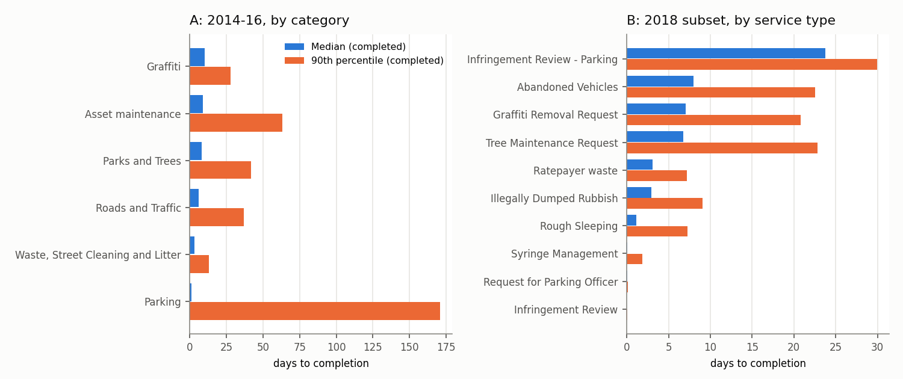
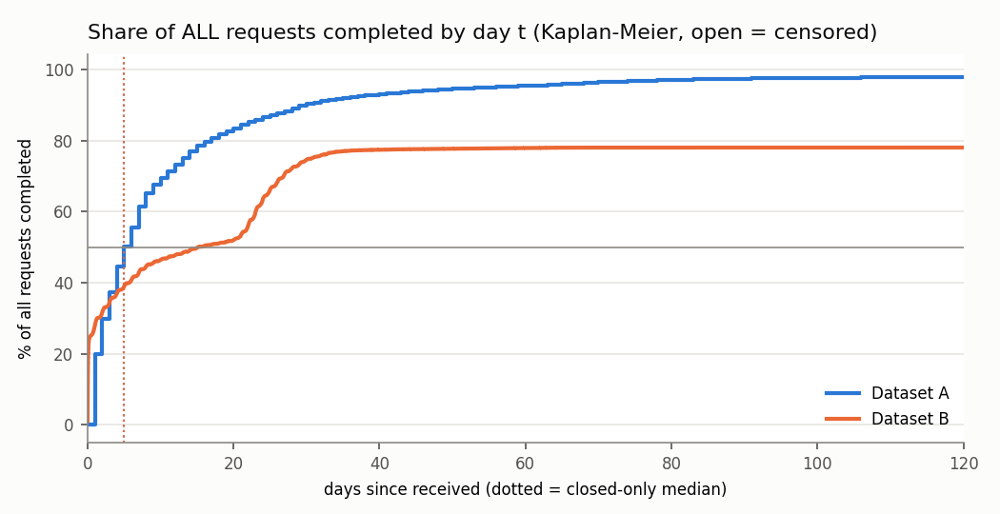
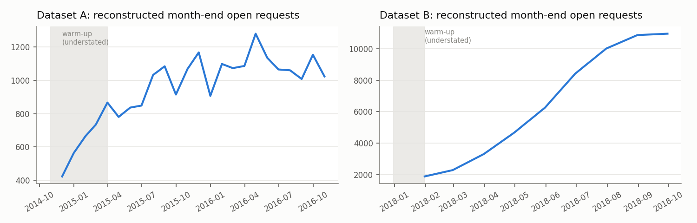

# KPI Reliability Report: City of Melbourne Customer Service Requests

*Dashboard Reliability Lab. Generated by `src/run_pipeline.py`; KPI definitions v1.1.0
(`config/kpi_definitions.json`). Every number below is read from the pipeline tables.*

**Question:** what happens when a dashboard is technically correct but the business conclusion is wrong?

## Executive summary

1. **Every KPI is computed correctly**: SQL and an independent Python recomputation agree (PASS 88); row counts
   reconcile through every transformation; no invalid dates.
2. **Not every correct KPI is meaningful.** In Dataset B (2018), the closed-only median is **5.0 days**, but
   9,491 requests (22%) are still open with a median age of **155 days**
   (83% older than 90 days). Counting open requests as censored, the Kaplan-Meier median is
   **15.1 days** and the 90th percentile is never reached during follow-up. A manager reading only the
   median would conclude the service is fast.
3. **Rankings reverse.** In Dataset A, *Parking* is the fastest category on median (1 day) but has the
   **longest** 90th percentile (171 days), the lowest 30-day closure rate (71%) and the oldest
   open requests (228 days). *Graffiti* is slowest on median (10 days) but 2nd best on
   p90. Across both datasets there are 62 pairwise reversals against the median ranking.
4. **The trend conclusion depends on the KPI.** 2016 vs 2015 (A): median worsened,
   p90 improved, 30-day closure improved.
5. **Coverage limits interpretation.** Dataset B is a **subset** from one of several council systems and is half
   parking infringement reviews; the two datasets do not overlap in time and are never combined. Both are stale
   (latest records 2016 and 2018).
6. **A naive KPI is wrong by construction.** Dataset A's `days_to_complete` holds the *age* of open requests, not a
   completion time; a median over the whole column (K07) mixes the two. It happens to equal the correct value overall
   (5 days) because only 1.8% of A is open, which is exactly why it would pass a casual check.

## 1. Sources and versioning

| dataset | file | rows | portal_records_count | portal_modified | sha256_12 |
|---|---|---|---|---|---|
| A | customer-service-requests-with-resolution-time.csv | 46479 | 46479 | 2022-12-14T02:22:14+00:00 | 2136223323f5 |
| B | customer-service-requests-with-digital-channel-information.csv | 42221 | 42221 | 2026-09-03T12:54:49+00:00 | f339a9122d25 |

Row lineage (raw → staging → analysis view → KPI population → cohort table):

| dataset | step | rows |
|---|---|---|
| A | raw | 46479 |
| A | staging | 46479 |
| A | analysis view | 46479 |
| A | KPI population closed+open | 46479 |
| A | cohort table | 46479 |
| B | raw | 42221 |
| B | staging | 42221 |
| B | analysis view | 42221 |
| B | KPI population closed+open | 42221 |
| B | cohort table | 42221 |

## 2. Data Quality Engine: checks and KPI impact

Each rule records rows flagged and what happens to the KPIs it touches if those rows are excluded.

| rule_id | dataset | check | severity | rows_flagged | rate % | status | kpi_impact_if_excluded |
|---|---|---|---|---|---|---|---|
| DQ01 | A | Date received missing or unparseable | critical | 0 | 0.00 | PASS | K01: 5 -> 5 (+0); K05: 0.0183 -> 0.0183 (+0) |
| DQ01 | B | Date opened missing or unparseable | critical | 0 | 0.00 | PASS | K01: 4.97 -> 4.97 (+0); K05: 0.225 -> 0.225 (+0) |
| DQ02 | A | Date completed present but unparseable | critical | 0 | 0.00 | PASS | K01: 5 -> 5 (+0); K02: 28 -> 28 (+0) |
| DQ02 | B | Date closed present but unparseable | critical | 0 | 0.00 | PASS | K01: 4.97 -> 4.97 (+0); K02: 26.9 -> 26.9 (+0) |
| DQ03 | A | Completed before received | critical | 0 | 0.00 | PASS | K01: 5 -> 5 (+0); K02: 28 -> 28 (+0) |
| DQ03 | B | Closed before opened | critical | 0 | 0.00 | PASS | K01: 4.97 -> 4.97 (+0); K02: 26.9 -> 26.9 (+0) |
| DQ04 | A | Date after the extract date | high | 0 | 0.00 | PASS | K04: 29 -> 29 (+0) |
| DQ04 | B | Date after the extract date | high | 0 | 0.00 | PASS | K04: 155 -> 155 (+0) |
| DQ05 | A | Status closed but no completion date | high | 0 | 0.00 | PASS | K01: 5 -> 5 (+0); K02: 28 -> 28 (+0) |
| DQ05 | B | Status closed but no close date | high | 0 | 0.00 | PASS | K01: 4.97 -> 4.97 (+0); K02: 26.9 -> 26.9 (+0) |
| DQ06 | A | Status open but has a completion date | medium | 1 | 0.00 | WARN | K05: 0.0183 -> 0.0182 (-2.11e-05); K04: 29 -> 29 (+0) |
| DQ06 | B | Status open but has a close date | medium | 0 | 0.00 | PASS | K05: 0.225 -> 0.225 (+0); K04: 155 -> 155 (+0) |
| DQ07 | A | days_to_complete populated on open request (holds age, not completion time) | high | 849 | 1.83 | WARN | K07: 5 -> 5 (+0) |
| DQ08 | A | days_to_complete differs from calendar days (same-day = 1 convention) | medium | 0 | 0.00 | PASS | K01: 5 -> 5 (+0) |
| DQ09 | A | Suburb missing | medium | 24894 | 53.56 | WARN | no numeric KPI impact |
| DQ09 | B | Suburb missing | medium | 22618 | 53.57 | WARN | no numeric KPI impact |
| DQ10 | B | Suburb spelling variant (e.g. 'Melb CBD', lower case) | low | 67 | 0.16 | WARN | no numeric KPI impact |
| DQ11 | B | Suburb outside City of Melbourne municipality | low | 35 | 0.08 | WARN | no numeric KPI impact |
| DQ12 | B | Closed as Duplicate (not a resolved service request) | medium | 716 | 1.70 | WARN | K01: 4.97 -> 5.14 (+0.171); K02: 26.9 -> 26.9 (+0.0436); K05: 0.225 -> 0.229 (+0.00388) |
| DQ13 | A | Freshness: latest record 2016-11-08, 3643 days before this run | high | 46479 | 100.00 | WARN | KPIs describe the past, not current service performance |
| DQ13 | B | Freshness: latest record 2018-10-17, 2935 days before this run | high | 42221 | 100.00 | WARN | KPIs describe the past, not current service performance |
| DQ14 | A | Row count matches portal record count | critical | 0 | 0.00 | PASS |  |
| DQ14 | B | Row count matches portal record count | critical | 0 | 0.00 | PASS |  |
| DQ15 | A | Exact duplicate rows (no request ID exists to test true duplicates) | medium | 0 | 0.00 | PASS |  |
| DQ15 | B | Exact duplicate rows (no request ID exists to test true duplicates) | medium | 0 | 0.00 | PASS |  |
| DQ16 | A | Partial months at the edges (< 50% of median monthly volume): 2016-11 | medium | 382 | 0.82 | WARN | exclude from month-on-month comparisons |
| DQ16 | B | Partial months at the edges (< 50% of median monthly volume): 2018-10 | medium | 34 | 0.08 | WARN | exclude from month-on-month comparisons |
| DQ17 | B | Requests whose month differs between UTC and Melbourne time | low | 551 | 1.31 | PASS | handled: months assigned in local time |

## 3. KPI Integrity: correct vs meaningful

Question tested: *"How long do residents wait for a request to be resolved?"*

| dataset | kpi | name | value | meaningful | reason |
|---|---|---|---|---|---|
| A | K01 | Median days to completion | 5.00 | Meaningful | only 1.8% open; censoring-aware median within 0.0 days |
| A | K02 | 90th percentile days to completion | 28.00 | Meaningful | only 1.8% open; censoring-aware median within 0.0 days |
| A | K03 | Closure rate within 30 days by intake cohort | 0.90 | Meaningful | cohort-based: open requests count as not closed; only cohorts with a full 30-day window |
| A | K04 | Open-case ageing | 29.00 | Meaningful | directly describes the open backlog at extract; one snapshot only |
| A | K05 | Open share | 0.02 | Partial | depends on the age mix of intake; compare like-aged cohorts (K03) |
| A | K06 | Kaplan-Meier median days to completion | 5.00 | Meaningful (with assumption) | keeps open requests as censored; KM p90 30 days; assumes non-informative censoring |
| A | K07 | Naive median of days_to_complete (anti-pattern) | 5.00 | Not meaningful | mixes completion times of closed requests with ages of open requests |
| B | K01 | Median days to completion | 4.97 | Not meaningful on its own | 22.5% of requests are open and excluded (median age 155 days) |
| B | K02 | 90th percentile days to completion | 26.88 | Not meaningful on its own | 22.5% of requests are open and excluded (median age 155 days) |
| B | K03 | Closure rate within 30 days by intake cohort | 0.73 | Meaningful | cohort-based: open requests count as not closed; only cohorts with a full 30-day window |
| B | K04 | Open-case ageing | 155.00 | Meaningful | directly describes the open backlog at extract; one snapshot only |
| B | K05 | Open share | 0.22 | Partial | depends on the age mix of intake; compare like-aged cohorts (K03) |
| B | K06 | Kaplan-Meier median days to completion | 15.13 | Meaningful (with assumption) | keeps open requests as censored; KM p90 not reached in follow-up; assumes non-informative censoring |

## 4. KPI Stress Test

Rank 1 = best on that KPI. Groups with >= 200 requests.

**Dataset A**

| Service group | Median d (rank) | P90 d (rank) | Closed <=30d (rank) | Open median age (rank) | Open share (rank) | KM median d (rank) |
|---|---|---|---|---|---|---|
| Parking | 1.0 (1) | 170.8 (6) | 71% (5) | 228 (6) | 8.4% (6) | 1.0 (1) |
| Waste, Street Cleaning and Litter | 3.0 (2) | 13.0 (1) | 97% (1) | 11 (2) | 1.1% (3) | 3.0 (2) |
| Roads and Traffic | 6.0 (3) | 37.0 (3) | 85% (3) | 64 (4) | 3.7% (4) | 7.0 (3) |
| Parks and Trees | 8.0 (4) | 42.0 (4) | 85% (4) | 6 (1) | 1.0% (1) | 9.0 (4) |
| Asset maintenance | 9.0 (5) | 63.0 (5) | 71% (6) | 82 (5) | 3.9% (5) | 10.0 (5) |
| Graffiti | 10.0 (6) | 28.0 (2) | 91% (2) | 14 (3) | 1.1% (2) | 10.0 (5) |

**Dataset B**

| Service group | Median d (rank) | P90 d (rank) | Closed <=30d (rank) | Open median age (rank) | Open share (rank) | KM median d (rank) |
|---|---|---|---|---|---|---|
| Infringement Review | 0.0 (1) | 0.0 (1) |  |  | 0.0% (1) | 0.0 (1) |
| Request for Parking Officer | 0.0 (2) | 0.1 (2) | 98% (3) | 151 (5) | 1.6% (4) | 0.0 (2) |
| Syringe Management | 0.1 (3) | 1.8 (3) | 99% (2) | 103 (2) | 1.3% (3) | 0.1 (3) |
| Rough Sleeping | 1.1 (4) | 7.3 (5) | 99% (1) | 154 (6) | 0.5% (2) | 1.1 (4) |
| Illegally Dumped Rubbish | 3.0 (5) | 9.0 (6) | 97% (4) | 146 (4) | 2.9% (6) | 3.0 (5) |
| Ratepayer waste | 3.0 (6) | 7.2 (4) |  | 35 (1) | 1.6% (5) | 3.1 (6) |
| Tree Maintenance Request | 6.7 (7) | 22.9 (9) | 77% (6) | 168 (9) | 18.9% (8) | 8.0 (8) |
| Graffiti Removal Request | 7.1 (8) | 20.8 (7) | 86% (5) | 134 (3) | 10.8% (7) | 8.0 (7) |
| Abandoned Vehicles | 8.0 (9) | 22.5 (8) | 75% (7) | 158 (8) | 20.5% (9) | 11.2 (9) |
| Infringement Review - Parking | 23.7 (10) | 29.9 (10) | 52% (8) | 156 (7) | 40.7% (10) | 28.0 (10) |

The dotted lines are the closed-only medians. For A, the KM curve crosses 50% at the same point: censoring is
negligible. For B the curve crosses 50% around day 15 and flattens below 90%: a large share of
requests never closes in the observation window.

## 5. Sensitivity Analysis

Headline KPIs and conclusions under alternative reasonable assumptions:

| dataset | scenario | requests | K01 | K02 | K03 | K06 | slowest_by_median | slowest_by_km |
|---|---|---|---|---|---|---|---|---|
| A | A0 baseline: published field, closed only, full extract | 46479 | 5.00 | 28.00 | 0.90 | 5.00 | Graffiti | Graffiti |
| A | A1 calendar days (same-day = 0) instead of published field | 46479 | 5.00 | 28.00 | 0.90 | 5.00 | Graffiti | Graffiti |
| A | A2 reporting period: calendar 2015 | 21680 | 5.00 | 32.00 | 0.89 | 5.00 | Parks and Trees | Parks and Trees |
| A | A3 reporting period: Jan-Oct 2016 | 21661 | 6.00 | 26.00 | 0.92 | 6.00 | Graffiti | Graffiti |
| A | A4 reporting period: FY 2015-16 | 24382 | 5.00 | 28.00 | 0.91 | 6.00 | Graffiti | Graffiti |
| A | A5 exclude partial edge months (Nov-2014, Nov-2016) | 44941 | 5.00 | 28.00 | 0.90 | 6.00 | Graffiti | Graffiti |
| A | A6 most recent 3 months only (Aug-Oct 2016) | 6423 | 6.00 | 22.00 | 0.92 | 6.00 | Graffiti | Graffiti |
| A | A7 exclude rows with missing suburb | 21585 | 5.00 | 25.00 | 0.93 | 5.00 | Graffiti | Graffiti |
| B | B0 baseline: Melbourne time, duplicates count as closed | 42221 | 4.97 | 26.88 | 0.73 | 15.13 | Infringement Review - Parking | Infringement Review - Parking |
| B | B1 exclude 'Closed as Duplicate' | 41505 | 5.14 | 26.92 | 0.72 | 17.03 | Infringement Review - Parking | Infringement Review - Parking |
| B | B2 exclude 'Infringement Review - Parking' (48% of rows) | 22088 | 0.38 | 12.98 | 0.93 | 0.89 | Abandoned Vehicles | Abandoned Vehicles |
| B | B3 reporting period: Q1 2018 | 14011 | 6.22 | 27.92 | 0.79 | 14.22 | Infringement Review - Parking | Infringement Review - Parking |
| B | B4 reporting period: Q3 2018 | 14200 | 7.17 | 25.86 | 0.84 | 14.01 | Infringement Review - Parking | Infringement Review - Parking |
| B | B5 Q3 2018 cut in UTC months | 14215 | 7.16 | 25.86 | 0.84 | 14.01 | Infringement Review - Parking | Infringement Review - Parking |
| B | B6 exclude rows with missing suburb | 19603 | 0.19 | 12.70 | 0.93 | 0.56 | Abandoned Vehicles | Abandoned Vehicles |

- Day-count convention (A1) and timezone (B5) change nothing material: those conclusions are **stable**.
- Excluding missing-suburb rows (A7, B6) changes B completely, because suburb is missing for whole service types
  (parking reviews): missing data are not random, so "exclude incomplete rows" is not a neutral cleaning step.
- Removing 'Closed as Duplicate' (B1) raises the KM median by about two days.

**Does the trend conclusion depend on the KPI?**

| dataset | KPI | periods | value_from | value_to | direction | comparability |
|---|---|---|---|---|---|---|
| A | Median days (completed) | CY2015 -> Jan-Oct 2016 | 5.00 | 6.00 | worsened | biased for recent periods: slow requests not yet closed are missing |
| A | P90 days (completed) | CY2015 -> Jan-Oct 2016 | 32.00 | 26.00 | improved | biased for recent periods: slow requests not yet closed are missing |
| A | Closed within 30 days, intake cohort | CY2015 -> Jan-Oct 2016 | 0.89 | 0.92 | improved | comparable: fixed 30-day window, only cohorts with full follow-up |
| A | Median age of open requests | CY2015 -> Jan-Oct 2016 | 442.50 | 49.00 | improved | not comparable: older intake periods can only have older open requests |
| A | Open share | CY2015 -> Jan-Oct 2016 | 0.00 | 0.03 | worsened | not comparable: recent intake has had less time to close |
| A | KM median days (open = censored) | CY2015 -> Jan-Oct 2016 | 5.00 | 6.00 | worsened | comparable with assumption: censoring handled, assumes non-informative censoring |
| B | Median days (completed) | Q1 2018 -> Q3 2018 | 6.22 | 7.17 | worsened | biased for recent periods: slow requests not yet closed are missing |
| B | P90 days (completed) | Q1 2018 -> Q3 2018 | 27.92 | 25.86 | improved | biased for recent periods: slow requests not yet closed are missing |
| B | Closed within 30 days, intake cohort | Q1 2018 -> Q3 2018 | 0.79 | 0.84 | improved | comparable: fixed 30-day window, only cohorts with full follow-up |
| B | Median age of open requests | Q1 2018 -> Q3 2018 | 216.00 | 80.00 | improved | not comparable: older intake periods can only have older open requests |
| B | Open share | Q1 2018 -> Q3 2018 | 0.16 | 0.13 | improved | not comparable: recent intake has had less time to close |
| B | KM median days (open = censored) | Q1 2018 -> Q3 2018 | 14.22 | 14.01 | improved | comparable with assumption: censoring handled, assumes non-informative censoring |

## 6. Coverage Assessment

| dataset | aspect | finding | implication |
|---|---|---|---|
| A | Period covered | 10 Nov 2014 to 08 Nov 2016 (25 intake months); extract date 08 Nov 2016 | KPIs describe this window only |
| A | Source system | Requests for service logged by members of the public relating to waste, graffiti, parking, roads and traffic, parks and trees and assets in a public space. REQUEST_STATUS - The current status of the request. This can be a combination of: CLOSED (completed/resolved), WIP (work in progress), REASSIGNE | Council request system; confidential requests removed by publisher |
| A | Suburb missingness by service group | Asset maintenance: 87%; Parking: 86%; Roads and Traffic: 85%; Waste, Street Cleaning and Litter: 54%; Graffiti: 39% | Missing not at random: excluding missing-suburb rows changes the service mix and therefore every KPI (see sensitivity A7/B6) |
| B | Period covered | 01 Jan 2018 to 01 Oct 2018 (10 intake months); extract date 17 Oct 2018 | KPIs describe this window only |
| B | Source system | This dataset contains service requests received from external customers. This data is collected through the council's Salesforce system. It contains information about the service type, status, and dates for received and closed. This dataset only contains a subset of the received requests as it is ex | Subset of council requests (one of several systems): must not be presented as all council activity |
| B | Suburb missingness by service group | General Enquiry: 100%; Infringement Review: 100%; Infringement Review - Animal Management: 100%; Infringement Review - Local Law: 100%; Other: 100% | Missing not at random: excluding missing-suburb rows changes the service mix and therefore every KPI (see sensitivity A7/B6) |
| A+B | Overlap between datasets | No time overlap: A ends Nov 2016, B starts Jan 2018; different status vocabularies (5 vs 10 values) and taxonomies (6 categories vs 14 service types) | Datasets cannot be merged, trended together or used to estimate B's share of all requests |
| B | Channel coverage | Digital 66%, assisted 33%, council-initiated 1%; 'Infringement Review - Parking' is 48% of rows | Digital share describes Salesforce-handled requests only, and is dominated by parking reviews |

## 7. Backlog history: what cannot be reconstructed

| limitation | detail |
|---|---|
| Left truncation | Requests received before the first date in the extract, but still open, are absent; backlog is understated until the warm-up period ends. |
| No status history | Only the current status is published. Reassignments, reopenings and time spent in each status cannot be reconstructed. |
| Removed records | Confidential requests were removed by the publisher (A); B is one system of several. Missing records cannot be counted. |
| Completion definition | A's metadata says days_to_complete excludes time referred to other authorities, but every closed row equals calendar days (same-day = 1); either no exclusion was applied or it is not visible. Paused time cannot be recovered. |
| Single extract | One snapshot per dataset. A month-end backlog derived from it is an estimate, not a recorded backlog; it cannot be reconciled to any operational backlog report. |
| Accumulating open records (B) | Reconstructed open requests in B rise from 1,896 to 10,947 in nine months; 7,547 of 9,491 open records have status 'New'. The data cannot distinguish a genuine backlog from requests resolved elsewhere but never closed in Salesforce: requires investigation before any backlog KPI is published. |

## 8. Decision Evidence Report

| Management question | Use | Do not use alone | Evidence | Limits |
|---|---|---|---|---|
| How fast do we resolve requests? | K06 KM median + K02 p90 + K04 open ageing | K01 median (closed only) | Sections 3-4 | B: 90th percentile not reached; KM assumes non-informative censoring |
| Which service needs attention first? | Rank on K02, K03 and K04 together; investigate groups that are bad on 2+ | K01 ranking | Section 4 reversals | Groups < 200 requests not ranked |
| Is performance improving? | K03 by intake cohort (fixed window) | K01, K04, K05 across periods | Section 5 trend | Only cohorts with 30-day follow-up |
| How large is the backlog? | K04 snapshot at extract | Reconstructed history before warm-up; any B backlog figure | Section 7 | B open records may be unclosed records, not work |
| What share of requests come through digital channels? | B channel mix, labelled "Salesforce subset, 2018" | Any council-wide channel claim | Section 6 | Subset of systems; 48% parking reviews |
| How do suburbs compare? | Only within service types with low suburb missingness | Any all-service suburb ranking | Sections 2, 5 | Suburb missing for 54% of rows, not at random |

**Conclusions that ARE supported:** A's typical completion times (median 5 days, p90 about 28 days) are robust to
day-count, period and censoring choices; Parking (A) has a long tail that the median hides; B has a large, ageing
pool of open records concentrated in parking infringement reviews.

**Conclusions that are NOT supported:** "service is fast" from B's median; "2016 was worse than 2015" from the median
alone; any statement about all council requests from B; any backlog trend for B.

## 9. Automated QA

Test run: `15 passed, 1 warning in 0.28s` (JUnit XML in `outputs/governance/test_results.xml`; every run appended to
`outputs/governance/qa_log.jsonl` with source hashes and KPI-definition version).

## Assumptions

| id | text | impact |
|---|---|---|
| AS01 | Extract date is not published; it is taken as the latest date present in each file (A: 2016-11-08, B: 2018-10-17). | Ages of open requests and cohort follow-up windows depend on it. |
| AS02 | Dataset A 'days_to_complete' for CLOSED rows equals calendar days with same-day completions recorded as 1. For open rows the field holds the age at extract, not a completion time. | A naive median over the whole column mixes completion times with open-case ages (K07). |
| AS03 | Dataset B status 'Closed as Duplicate' is closed; all other non-'Closed' statuses are open. | Duplicates close fast and pull B's completion KPIs down; tested in sensitivity. |
| AS04 | Dataset B timestamps are UTC; business dates and months use Australia/Melbourne local time. | Requests opened near midnight move day/month. |
| AS05 | Datasets A and B are never combined: different systems, periods, taxonomies and status vocabularies; B is a subset of council requests. | No KPI spans both. |
