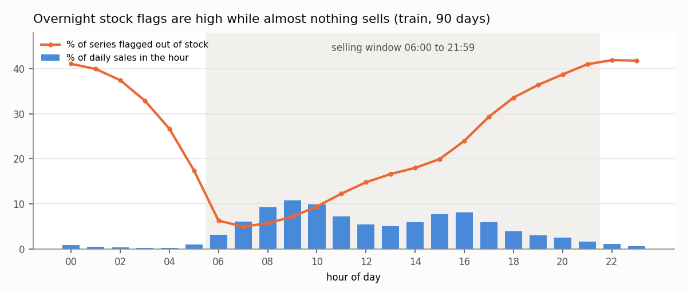
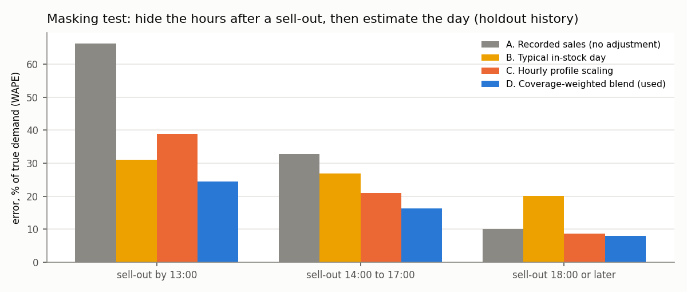
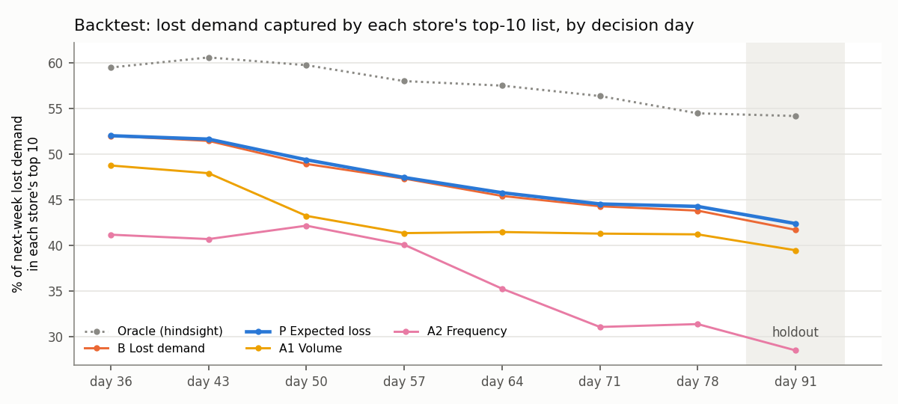
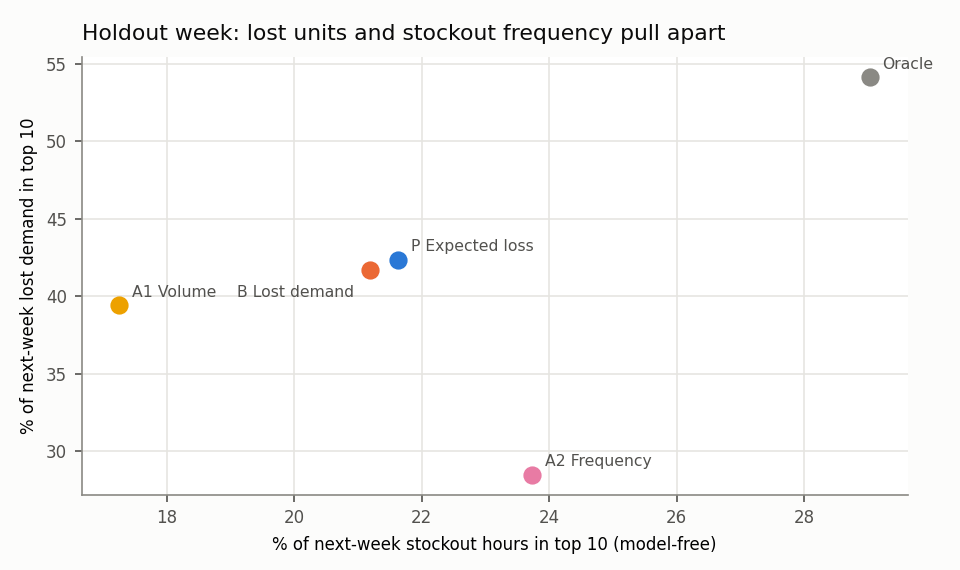

# Availability to Action: Inventory Decision Evidence Report

**Data:** FreshRetailNet-50K (Dingdong Inc., CC BY 4.0): 4,500,000 train
and 350,000 eval store-product-days, 50,000 series, 898 stores, 865 products,
2024-03-28 to 2024-07-02. Sales are normalised units (the publisher scales them), so results
are shares and ratios, never currency. **Params:** v1.0.0 ([config/params.json](../config/params.json)).
**DQ:** 6 pass, 4 warn, 0 fail. **Tests:** 14 passed, 1 warning in 1.36s.

## Executive brief

**Decision supported.** Each week, which store-product series should an inventory planner review first, and what
should they check before acting? Users: inventory planner, merchandise analyst, operations manager.

**What the evidence shows (verified on held-out data):**

1. **Recorded sales understate demand.** In the 28 days before the holdout week, 41% of
   store-product-days had at least one stockout hour in the selling window. When we hide the hours after a sell-out on 806,550 real in-stock days, recorded sales
   miss **35%** of the true day; the recovery method used here cuts the error to **16%**
   (hourly-profile scaling alone: 22%). On partial stockout days the estimated hidden demand is
   27% on top of recorded sales; across all days 11.4%.
2. **Ranking by estimated lost demand beats the two common rules.** On the holdout week each store's top-10 list
   under the proposed method holds **42.4%** of next-week lost demand, against
   39.5% for 'top sellers first' and 28.5% for 'most
   frequent stockouts first' (hindsight ceiling: 54.2%).
3. **The extra complexity buys almost nothing.** The proposed score
   (recency weighting + shrinkage) beats the simple 28-day lost-demand rule (B) by
   +0.7 points (95% store-bootstrap interval +0.4 to
   +0.9). Real, but small: B is good enough to deploy and far easier to explain.
4. **The right rule depends on the objective.** The frequency rule captures the most stockout *hours*
   (23.7% vs 21.6%):
   it is the better list if the goal is fewer empty-shelf incidents rather than fewer lost units.
5. **Confidence tiers carry real information.** For listed series, realised next-week lost demand was
   86% of the expected value for High-confidence series but only
   54% for Low-confidence ones: low-confidence scores overstate the
   problem and need a stock check before anyone orders more.

**Recommendation (with conditions).** Use the 28-day lost-demand ranking (B or P) to build each store's weekly
top-10 review list, show the confidence tier and the reasons next to every row, and switch to the frequency rule
where the objective is shelf availability rather than units. This is a *review* list, not an order: the dataset has
no on-hand inventory, lead times, order costs or margins, so it cannot say how much to order or what a stockout
costs. Before any claim of savings, the list should be piloted against current practice with those data added.

## 1. The decision, the users and the baselines

| | |
|---|---|
| Decision | Which store-product series to review first for the coming week (top 10 per store, 8,947 rows across 898 stores) |
| Users | Inventory planner (acts on the list), merchandise analyst (checks reasons, ranging), operations manager (store-level view) |
| Decision time | Day T; only days T-28 to T-1 are visible. Outcome measured on T to T+6 |
| Baseline A1 | Recorded sales, last 28 days ('protect the top sellers') |
| Baseline A2 | Days with a stockout, last 28 days ('repeat offenders') |
| Baseline B | Estimated lost demand, last 28 days (stockout-adjusted) |
| Proposed P | Expected next-week lost demand: recency-weighted recovered demand x unserved share shrunk toward the store x category share; half-life and shrinkage chosen on development folds (P Expected loss (hl=14 m=7)) |
| Primary metric | Share of next-week lost demand inside each store's top 10, summed over stores (fixed before the holdout was scored) |

## 2. Data foundation and quality

| rule_id | check | status | rows_flagged | rate | decision_impact | treatment |
|---|---|---|---|---|---|---|
| DQ01 | Grain: one row per store, product and date | PASS | 0 | 0.00% | Duplicate days would double-count demand and stockout hours | None needed |
| DQ02 | Complete panel: every series has 90 train + 7 eval consecutive days | PASS | 0 | 0.00% | Missing days would read as zero demand in the 28-day features | None needed |
| DQ03 | Hourly sales sum to daily sales | PASS | 0 | 0.00% | Hourly recovery would not reconcile with reported daily sales | None needed |
| DQ04 | stock_hour6_22_cnt equals the hourly flags for hours 6 to 21 | PASS | 0 | 0.00% | Confirms the publisher's selling window is 06:00 to 21:59 (16 hours), not 06:00 to 22:59 | Selling window fixed at hours 6 to 21 in config/params.json |
| DQ05 | Hierarchy: each product in one category path, each store in one city | PASS | 0 | 0.00% | Category and city roll-ups would split or double-count | None needed |
| DQ06 | Sales recorded in an out-of-stock hour that follows another out-of-stock hour | WARN | 248080 | 5.12% | 353,530 days have sales in some flagged hour; most are the sell-out hour itself (sold out mid-hour). The stricter rule leaves 248,080 days (1.0% of window sales) where the flag and the till disagree, so a flag is evidence of a stockout, not proof | Recorded sales are kept and recovered demand is floored at them; series with 3+ such days get a 'check the stock-status feed' item on the review list |
| DQ07 | Out-of-stock flags outside the selling window (22:00 to 05:59) | WARN | 2830124 | 58.35% | Counting all 24 hours puts 24.7% of hours and 59.8% of days out of stock; the selling window gives 19.7% of hours and 44.0% of days. 93% of 00:00 flags follow a stockout at 21:00 the evening before, so a 24-hour KPI counts one evening sell-out on two days | Every availability KPI uses the selling window only |
| DQ08 | Out of stock for the whole selling window | WARN | 194332 | 4.01% | No in-stock hour to recover from (35,937 of these days still record sales). Imputing a typical day would add 21% to estimated lost demand, an assumption the masking test cannot check (a whole-day stockout may also be a ranging decision) | Reported as 'unavailable days', kept out of the lost-demand target and the scores |
| DQ09 | Discount within (0, 1] | WARN | 17373 | 0.36% | discount = 0 (published meaning: free) on these rows comes with sales 16x the average: more likely a missing-value code than a giveaway. Discount is not used by any score | Flagged only; would need publisher confirmation before any price-effect analysis |
| DQ10 | No negative sales | PASS | 0 | 0.00% | Negative demand | None needed |

The finding that changes decisions most is **DQ07**: the hourly stock flag stays on overnight after an evening
sell-out. A KPI built on all 24 hours reports a far higher stockout rate than the selling-window KPI used here, and
it counts an item that sells out at 21:00 as out of stock on two days instead of one.



## 3. Recorded sales understate demand: the masking test

Real stockout days have no ground truth, so the method is tested where truth exists: on fully in-stock days, the
hours after a sell-out time (drawn from the real sell-out distribution) are hidden and each estimator rebuilds the
day. The estimator was chosen on the development fold (decision day 78) and
confirmed on the holdout history; the masked day never informs its own profile.

| role | sell-out | estimator | days | wape | bias |
|---|---|---|---|---|---|
| development (method chosen here) | 1. all | A. Recorded sales (no adjustment) | 836971 | 33.9% | -33.9% |
| development (method chosen here) | 1. all | B. Typical in-stock day | 836971 | 26.0% | +5.6% |
| development (method chosen here) | 1. all | C. Hourly profile scaling | 836971 | 21.9% | +0.1% |
| development (method chosen here) | 1. all | D. Coverage-weighted blend (used) | 836971 | 15.9% | -0.4% |
| holdout (confirmation) | 1. all | A. Recorded sales (no adjustment) | 806550 | 34.6% | -34.6% |
| holdout (confirmation) | 1. all | B. Typical in-stock day | 806550 | 25.8% | +5.3% |
| holdout (confirmation) | 1. all | C. Hourly profile scaling | 806550 | 21.8% | +0.1% |
| holdout (confirmation) | 1. all | D. Coverage-weighted blend (used) | 806550 | 15.8% | -0.4% |
| holdout (confirmation) | 2. sell-out by 13:00 | A. Recorded sales (no adjustment) | 223664 | 66.2% | -66.2% |
| holdout (confirmation) | 2. sell-out by 13:00 | B. Typical in-stock day | 223664 | 31.1% | -0.0% |
| holdout (confirmation) | 2. sell-out by 13:00 | C. Hourly profile scaling | 223664 | 38.8% | -0.0% |
| holdout (confirmation) | 2. sell-out by 13:00 | D. Coverage-weighted blend (used) | 223664 | 24.5% | -0.7% |
| holdout (confirmation) | 3. sell-out 14:00 to 17:00 | A. Recorded sales (no adjustment) | 318397 | 32.8% | -32.8% |
| holdout (confirmation) | 3. sell-out 14:00 to 17:00 | B. Typical in-stock day | 318397 | 26.9% | +4.3% |
| holdout (confirmation) | 3. sell-out 14:00 to 17:00 | C. Hourly profile scaling | 318397 | 20.9% | +0.2% |
| holdout (confirmation) | 3. sell-out 14:00 to 17:00 | D. Coverage-weighted blend (used) | 318397 | 16.2% | -0.4% |
| holdout (confirmation) | 4. sell-out 18:00 or later | A. Recorded sales (no adjustment) | 264489 | 10.1% | -10.1% |
| holdout (confirmation) | 4. sell-out 18:00 or later | B. Typical in-stock day | 264489 | 20.0% | +10.9% |
| holdout (confirmation) | 4. sell-out 18:00 or later | C. Hourly profile scaling | 264489 | 8.7% | +0.1% |
| holdout (confirmation) | 4. sell-out 18:00 or later | D. Coverage-weighted blend (used) | 264489 | 8.0% | -0.1% |

Development-fold rows by sell-out time are in `outputs/powerbi/an_masking_summary.csv`.



What it shows: for late sell-outs the hourly profile is enough; for sell-outs before 13:00 most of the day is hidden
and the typical in-stock day is the better guide. The coverage-weighted blend uses each where it is strong. What it
cannot show: full-day stockouts (DQ08) and any demand that shifts to a substitute product.

## 4. Does the adjustment improve a simple forecast?

Truth is next-week days with no stockout hour (the only days where recorded sales equal demand).

| role | forecast | days | wape | bias |
|---|---|---|---|---|
| development | Mean of recorded sales | 1426597 | 38.1% | -2.9% |
| development | Mean of recovered demand | 1426597 | 39.3% | +12.3% |
| holdout | Mean of recorded sales | 206562 | 36.0% | -10.7% |
| holdout | Mean of recovered demand | 206562 | 34.6% | +0.8% |

The result is mixed. On the holdout week the recovered mean removes most of the under-forecast
(-10.7% to +0.8%);
on the development weeks it over-forecasts (+12.3%). Part
of this is selection: in-stock days are, by construction, days when demand did not exhaust stock, so they understate
demand. A forecasting claim needs a better truth set; the prioritisation result does not depend on it.

## 5. Prioritisation backtest

Seven development decision days inside the train period and one holdout (the eval split, never used to choose
anything). Variant selection on development folds:

| method | dev_mean | chosen |
|---|---|---|
| P hl=14 m=7 | 47.85% | True |
| P hl=14 m=0 | 47.81% | False |
| P hl=7 m=7 | 47.76% | False |
| P hl=1000 m=7 | 47.64% | False |
| P hl=1000 m=0 | 47.59% | False |
| P hl=7 m=0 | 47.55% | False |
| P hl=3.5 m=7 | 47.12% | False |
| P hl=3.5 m=0 | 46.56% | False |

| role | method | folds | lost demand in store top 10 | worst fold | stockout hours in store top 10 | lost demand in global top 10% | unavailable days in store top 10 |
|---|---|---|---|---|---|---|---|
| development | A1 Volume | 7 | 43.6% | 41.2% | 16.5% | 36.3% | 18.6% |
| development | A2 Frequency | 7 | 37.4% | 31.1% | 26.2% | 30.0% | 32.6% |
| development | B Lost demand | 7 | 47.6% | 43.8% | 21.4% | 40.0% | 27.2% |
| development | Oracle (hindsight) | 7 | 58.0% | 54.4% | 29.5% | 49.6% | 28.7% |
| development | P Expected loss (hl=14 m=7) | 7 | 47.9% | 44.3% | 21.8% | 40.3% | 27.9% |
| holdout | A1 Volume | 1 | 39.5% | 39.5% | 17.3% | 32.3% | 22.3% |
| holdout | A2 Frequency | 1 | 28.5% | 28.5% | 23.7% | 18.3% | 26.5% |
| holdout | B Lost demand | 1 | 41.7% | 41.7% | 21.2% | 34.0% | 25.8% |
| holdout | Oracle (hindsight) | 1 | 54.2% | 54.2% | 29.0% | 45.7% | 30.3% |
| holdout | P Expected loss (hl=14 m=7) | 1 | 42.4% | 42.4% | 21.6% | 34.6% | 26.4% |



Holdout differences, proposed minus baseline (1,000 store bootstrap resamples):

| metric | baseline | difference | ci_low | ci_high | verdict |
|---|---|---|---|---|---|
| store_top10_lost_capture | A1 Volume | +2.92% | +2.44% | +3.37% | better |
| store_top10_lost_capture | A2 Frequency | +13.88% | +13.18% | +14.59% | better |
| store_top10_lost_capture | B Lost demand | +0.69% | +0.45% | +0.93% | better |
| store_top10_hours_capture | A1 Volume | +4.38% | +4.05% | +4.69% | better |
| store_top10_hours_capture | A2 Frequency | -2.10% | -2.38% | -1.81% | worse |
| store_top10_hours_capture | B Lost demand | +0.44% | +0.30% | +0.58% | better |

Lost demand in the outcome week is itself estimated with the recovery model, which favours B and P. The stockout
hours column is model-free and gives the same order for B and P against A1, so the result is not an artefact of the
target. The interval treats stores as independent and covers one holdout week only.

## 6. Trade-off: lost units or empty-shelf incidents



High-volume items lose the most units when they sell out; frequent-stockout items are often low-volume. No single
list wins both. The dashboard shows both scores so the user picks the objective, rather than the model picking it
silently.

## 7. Confidence tiers

| confidence | series | listed | realised_over_expected_listed | listed_with_stockout_next_week | masked_days | masking_wape |
|---|---|---|---|---|---|---|
| High | 46645 | 7181 | 86% | 90% | 783468 | 15.8% |
| Medium | 2766 | 1426 | 61% | 94% | 21913 | 15.2% |
| Low | 589 | 340 | 54% | 99% | 1169 | 17.6% |

Tier rule: High = at most 30% of 28-day demand imputed and at least
7 fully in-stock days; Low = over
60% imputed or under 3
in-stock days. 99% of listed Low-tier items stock out again the
next week, but their lost demand is overstated: they need a stock
and ranging check, not an automatic order. Masking error barely differs by tier because Low-tier series have very few
in-stock days to mask, so the calibration column is the evidence.

## 8. The review list: one store

Store 11 (the store holding the single highest-scored series), holdout week:

| # | product | category | expected_lost_7d | confidence | reasons | realised_lost | realised_oos_hours |
|---|---|---|---|---|---|---|---|
| 1 | 267 | 184 | 72.40 | Low | Stocks out on 28 of the last 28 days; Typically sells out by 17:00; Estimated demand 38% above recorded sales; Top 20% of store demand | 33.80 | 9.00 |
| 2 | 300 | 24 | 6.10 | Medium | Stocks out on 20 of the last 28 days; Typically sells out by 11:00; Estimated demand 32% above recorded sales; Top 20% of store demand | 4.20 | 67.00 |
| 3 | 70 | 81 | 4.50 | High | Stocks out on 20 of the last 28 days; Typically sells out by 17:00; Stockouts rising: 7 of the last 7 days; Top 20% of store demand | 1.00 | 21.00 |
| 4 | 290 | 105 | 2.30 | High | Stocks out on 19 of the last 28 days; Typically sells out by 17:00; Top 20% of store demand | 2.20 | 25.00 |
| 5 | 191 | 81 | 2.10 | Medium | Stocks out on 15 of the last 28 days; Typically sells out by 13:00; Top 20% of store demand | 1.80 | 29.00 |
| 6 | 580 | 60 | 2.00 | High | Stocks out on 15 of the last 28 days; Typically sells out by 11:00; Top 20% of store demand | 1.90 | 27.00 |
| 7 | 292 | 104 | 1.90 | High | Typically sells out by 15:00; Top 20% of store demand | 3.00 | 36.00 |
| 8 | 351 | 142 | 1.50 | Medium | Stocks out on 19 of the last 28 days; Typically sells out by 12:00; Estimated demand 35% above recorded sales | 0.20 | 4.00 |
| 9 | 682 | 173 | 1.40 | Medium | Stocks out on 19 of the last 28 days; Typically sells out by 13:00; Estimated demand 40% above recorded sales | 0.60 | 13.00 |
| 10 | 41 | 77 | 1.40 | High | Typically sells out by 10:00; Top 20% of store demand | 2.20 | 22.00 |

Every row on the full list also carries `checks_before_acting` (on-hand stock, open orders and lead time are not in
this dataset).

## 9. Limits: what this evidence cannot support

- **No cost or saving claim.** No on-hand inventory, lead time, order cost, shelf life or margin data: lost demand is
  in normalised units and cannot be priced.
- **Association, not cause.** Stockouts may coincide with high-demand days, promotions or weather; the backtest shows
  the list finds future losses, not why they happen.
- **Substitution is ignored.** Some 'lost' demand moves to a neighbouring product; true net loss is lower.
- **One retailer, 97 days, one holdout week.** Seasonality and holiday effects beyond this window are untested.
- **User validation pending.** No planner has used the list yet; a usability test with 3 to 5 planners is the next
  step and would be reported separately from any business impact.

## 10. Reproduce

```bash
pip install duckdb pandas matplotlib pytest
python scripts/download_data.py   # 115 MB from Hugging Face
python src/run_pipeline.py        # ~2 minutes: rebuild, DQ, backtest, exports, tests, this report
```
